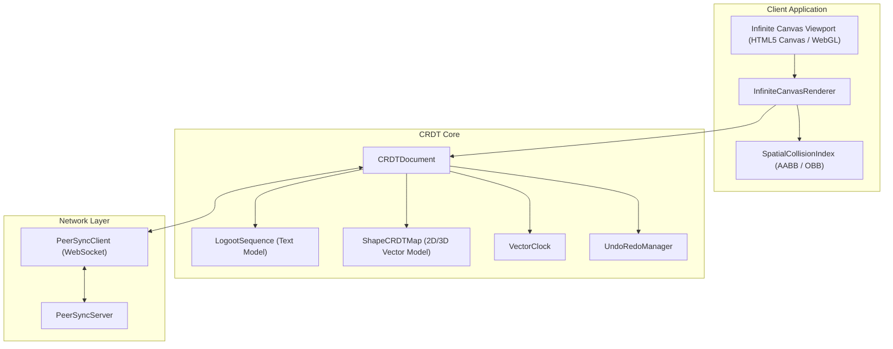

<div align="center">

# 🎨 CRDT Canvas Engine
### *Next-Generation Real-Time Collaborative Document & Code Canvas Engine*

[](https://github.com/ER-brocode/crdt-canvas-engine/actions/workflows/ci.yml)
[](https://www.typescriptlang.org/)
[](LICENSE)
[]()
[]()

<br/>

```
  ┌────────────────────────────────────────────────────────────────────────┐
  │                           INFINITE CRDT CANVAS                         │
  │                                                                        │
  │   [Peer A] ──── (Op: Insert 'X' @ [3,1]) ────► [CRDT State Router]      │
  │                                                         │              │
  │   [Peer B] ──── (Op: Move Shape #42)     ────► [Vector Clock]          │
  │                                                         │              │
  │                                                         ▼              │
  │                                                 [Convergence Engine]   │
  │                                                         │              │
  │                                                         ▼              │
  │                                               [Infinite 2D/3D Canvas]  │
  └────────────────────────────────────────────────────────────────────────┘
```

<p align="center">
  <b>Sub-millisecond Convergence</b> • <b>Infinite 2D/3D Viewport</b> • <b>Causal Vector Clocks</b> • <b>Decentralized P2P & Client-Server</b>
</p>

---

</div>

## 🌟 Overview

`crdt-canvas-engine` is a distributed collaborative canvas and rich document editing engine built ground-up in TypeScript. Designed for high-frequency collaborative whiteboards, architectural diagrams, visual programming, and shared text editing, it guarantees **Strong Eventual Consistency (SEC)** under arbitrary network partitions, latency spikes, and packet reordering.

### Key Capabilities
- **Logoot / LSeq-style Position CRDT**: Infinite fractional identifier tree ensuring deterministic total ordering with bounded identifier growth.
- **State-based & Operation-based Shape CRDT**: Field-level Last-Write-Wins (LWW) registers with deterministic Lamport tie-breaking.
- **Infinite Zoom 2D/3D Camera**: 60fps rendering pipeline supporting pan, smooth zoom scaling ($0.05\times - 25.0\times$), camera tilt, and frustum culling.
- **Spatial Collision Detection**: Precise 2D/3D Oriented Bounding Box (OBB) & Axis-Aligned Bounding Box (AABB) hit-testing with inverse transform projection.
- **Causal Synchronization**: Distributed `VectorClock` tracking happens-before relationships and concurrency conflicts.
- **PeerSync WebSocket Architecture**: Real-time room multiplexing, peer cursor awareness, and state snapshot transfer.
- **Undo / Redo Manager**: Non-destructive timeline history with undo/redo execution tracking.

---

## 🏛️ System Architecture



---

## 📦 Installation

```bash
npm install @er-brocode/crdt-canvas-engine ws
```

---

## 🚀 Quick Start

### 1. Initializing Collaborative Document & Canvas
```typescript
import { CRDTDocument, InfiniteCanvasRenderer } from '@er-brocode/crdt-canvas-engine';

// Initialize document with local site ID
const doc = new CRDTDocument('workspace-alpha', 'site-peer-1');

// Collaborative text modifications
doc.insertText(0, 'Hello Collaborative World!');

// Collaborative 2D/3D shapes
const shapeOp = doc.createShape(
  'node-arch-1',
  'rectangle',
  { x: 300, y: 200, scaleX: 1.5, scaleY: 1.2 },
  { fillColor: '#3b82f6', strokeColor: '#1d4ed8' },
  'Auth Microservice'
);

// Infinite Viewport Renderer
const renderer = new InfiniteCanvasRenderer(doc, 1920, 1080);
renderer.panBy(100, 50);
renderer.zoomAt(960, 540, 1.2);
```

### 2. Real-Time Peer Sync & Awareness
```typescript
import { PeerSyncServer, PeerSyncClient, CRDTDocument } from '@er-brocode/crdt-canvas-engine';

// Run WebSocket sync server
const server = new PeerSyncServer(8080);
await server.start();

// Connect client
const doc = new CRDTDocument('board-101', 'peer-alice');
const client = new PeerSyncClient(doc, {
  serverUrl: 'ws://localhost:8080',
  roomId: 'board-101',
  siteId: 'peer-alice',
  userName: 'Alice'
});

await client.connect();

// Broadcast cursor coordinates
client.sendAwareness({ x: 450, y: 280, z: 0 });

// Listen for peer cursor updates
client.onAwareness(({ siteId, cursor }) => {
  console.log(`Peer ${siteId} moved cursor to`, cursor);
});
```

---

## 🔬 Mathematical Verification & Convergence

### Logoot Identifier Model
Logoot represents positions as sequences of tuples:
$$P = \langle (d_1, s_1, c_1), (d_2, s_2, c_2), \dots, (d_k, s_k, c_k) \rangle$$
Where:
- $d_i \in [0, \text{BASE}-1]$ represents the spatial digit.
- $s_i \in \text{SiteId}$ is the unique peer identifier.
- $c_i \in \mathbb{N}$ is the logical clock counter.

Total order is strictly enforced via lexicographical ordering:
$$P_A < P_B \iff \exists i: \forall j < i, P_A[j] = P_B[j] \land P_A[i] < P_B[i]$$

---

## 🧪 Automated Test Suite

Run the full verification suite covering concurrent conflict resolution and eventual consistency:

```bash
# Run unit & convergence tests
npm test

# Run test coverage report
npm run test:coverage
```

### Verified Scenarios
- ✅ Dense fractional Logoot position allocation under 0-distance collisions.
- ✅ Interleaved concurrent text insertions and deletions at identical indices.
- ✅ Concurrent field-level Last-Write-Wins (LWW) register convergence.
- ✅ Non-blocking Vector Clock causality tracking ($happened\text{-}before$, concurrent).
- ✅ N-Peer random network delays and packet reordering convergence.
- ✅ 2D/3D oriented bounding box collision detection and hit testing.

---

## 🛠️ Project Structure

```
crdt-canvas-engine/
├── .github/
│   └── workflows/
│       └── ci.yml               # GitHub Actions CI matrix build & test
├── src/
│   ├── crdt/
│   │   ├── LogootPosition.ts    # Dense fractional index total order allocator
│   │   ├── LogootSequence.ts    # Text sequence CRDT model
│   │   ├── ShapeCRDT.ts         # 2D/3D Shape CRDT with LWW registers
│   │   ├── CRDTDocument.ts      # Composite document orchestrator
│   │   └── index.ts
│   ├── sync/
│   │   ├── VectorClock.ts       # Distributed causality tracking
│   │   ├── UndoRedoManager.ts   # Local timeline undo/redo manager
│   │   ├── PeerSyncServer.ts    # WebSocket sync server with room routing
│   │   ├── PeerSyncClient.ts    # Resilient sync client with awareness
│   │   └── index.ts
│   ├── canvas/
│   │   ├── SpatialCollisionIndex.ts  # AABB & OBB bounding box collision
│   │   ├── InfiniteCanvasRenderer.ts # Infinite zoom/pan 2D/3D renderer
│   │   └── index.ts
│   └── index.ts
├── tests/
│   ├── conflict-resolution.test.ts # Concurrent conflict resolution tests
│   └── state-convergence.test.ts   # N-peer convergence & collision tests
├── package.json
├── tsconfig.json
├── jest.config.js
└── README.md
```

---

## 📄 License

Licensed under the Apache License, Version 2.0. Copyright (c) 2026 koushik4475 / ER-brocode.
